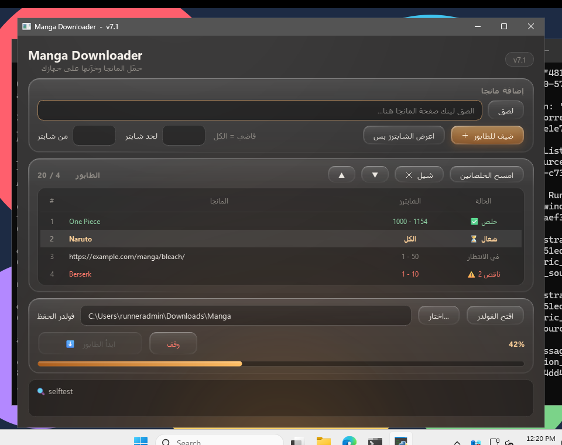

# Manga Downloader

برنامج بيحمّل المانجا من المواقع ويخزّنها على جهازك، في فولدر باسم المانجا وجواه فولدر لكل شابتر:

```
Manga/
  One Piece/
    Chapter 1000/
      001.jpg
      002.jpg
    Chapter 1001/
      ...
```

بيشتغل على **Windows** و**Mac** من نفس الكود.

| Windows | Mac |
|---|---|
|  |  |

## التحميل

ادخل على صفحة **[Releases](../../releases/latest)** ونزّل النسخة المناسبة لجهازك:

| الجهاز | الملف | التشغيل |
|---|---|---|
| Windows | `MangaDownloader-Windows.zip` | فك الضغط ودوس دبل كليك على `MangaDownloader.exe` |
| Mac | `MangaDownloader-Mac.zip` | افتحه واسحب `Manga Downloader` لفولدر Applications |

**أول مرة على Windows:** لو ظهرلك «Windows protected your PC»، دوس More info وبعدها Run anyway.

**أول مرة على Mac:** كليك يمين على البرنامج، اختار Open، وبعدها Open تاني.
لو مفتحش، روح System Settings ← Privacy & Security، وانزل لتحت ودوس Open Anyway.
ولو قالك إن البرنامج «damaged»، افتح Terminal واكتب:

```
xattr -cr "/Applications/Manga Downloader.app"
```

## المميزات

- طابور بيشيل لحد **20 مانجا**، ولكل واحدة الرينج بتاعها (من شابتر كام لحد كام).
- بيقرا ليستة الشابترز حتى لو مقسومة على صفحات (1 2 3 … 12).
- لو وقفته أو النت فصل، بيكمّل من مكان ما وقف، والطابور بيتحفظ حتى لو قفلت البرنامج.
- الصفحات اللي مش موجودة على الموقع نفسه بيتخطاها، وبيكتب أرقامها في ملف جوه فولدر الشابتر.
- بيبلّغك جوه البرنامج لما يكون فيه نسخة جديدة.

## إزاي تعمل تحديث (للمطوّر)

1. عدّل الكود في `manga_gui.py` أو `manga_scraper.py`.
2. غيّر رقم النسخة في `app_version.py`، مثلاً من `6.0` لـ `6.1`.
3. ارفع التعديل على `main`.

GitHub هيبني نسخة Windows ونسخة Mac لوحده في حوالي 5 دقايق، وينزّلهم في Releases. البرنامج المتسطب عند الناس هيقولهم إن فيه نسخة جديدة.

> لو رفعت تعديل من غير ما تغيّر رقم النسخة، الملفات في الـ Release هتتحدث، بس البرنامج مش هيبلّغ حد إن فيه تحديث.

## التشغيل من الكود (من غير build)

- **Windows:** دبل كليك على `start_windows.bat`
- **Mac:** دبل كليك على `start_mac.command` (محتاج Python من [python.org](https://www.python.org/downloads/macos/))

## الملفات

| الملف | وظيفته |
|---|---|
| `manga_gui.py` | الواجهة والطابور |
| `manga_scraper.py` | قراءة المواقع والتحميل (وينفع يشتغل لوحده من الـ terminal) |
| `app_version.py` | رقم النسخة واسم الريبو |
| `.github/workflows/build.yml` | بيبني الـ exe والـ app لوحده على GitHub |
